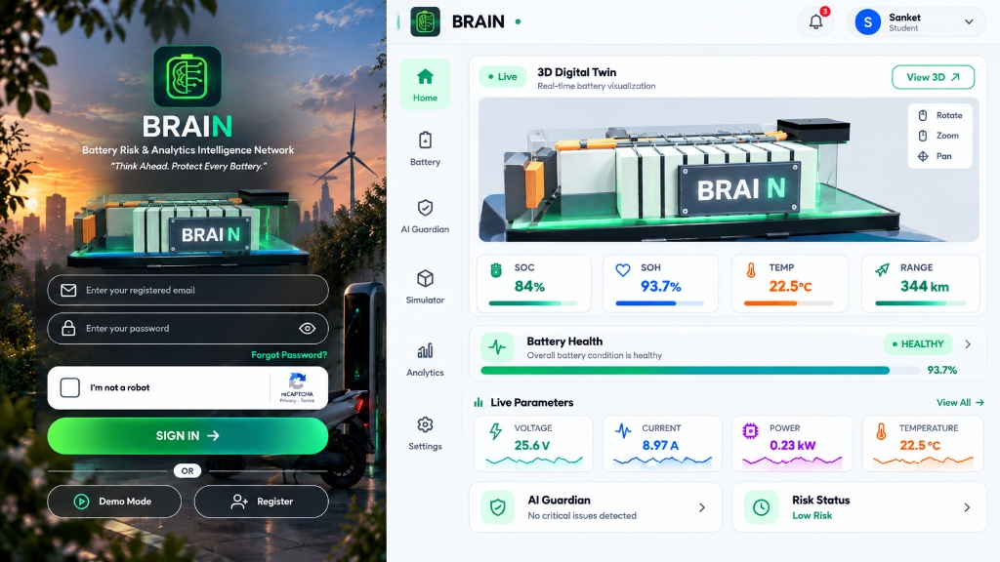
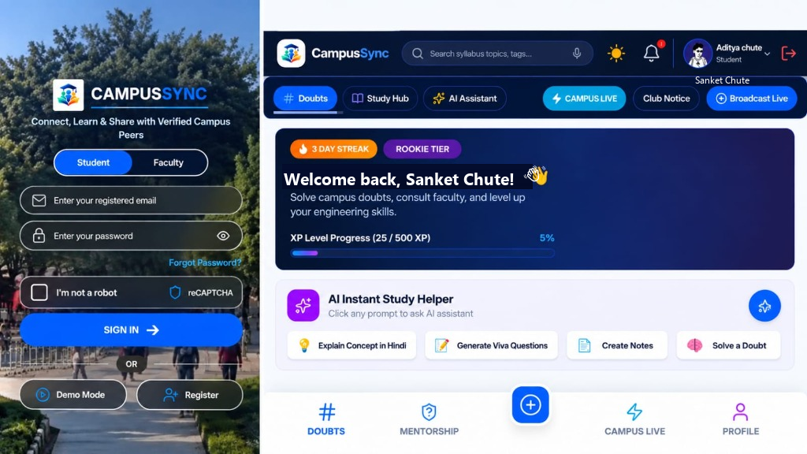
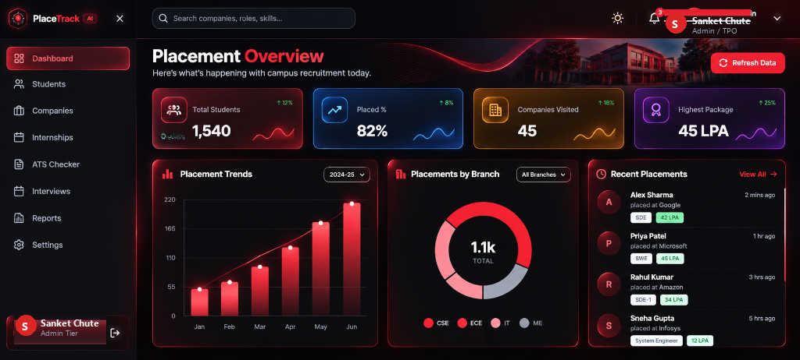

# Hi, I'm Sanket Chute 👋

---

## 📊 Live GitHub Engineering Stats

  
  

---

## 🚀 Featured Engineering Projects

<table width="100%">
  <tr>
    <td width="33.3%" valign="top">
      
      <h3>⚡ BRAIN — Battery Analytics</h3>
      

        
        
      

      
<strong>Cyber-Physical Electro-Thermal Digital Twin &amp; Hardware-Gated BLE Telemetry Ingestion Platform</strong>

      <ul>
        <li><strong>Physics AI (PINN)</strong>: Loss model predicting cell degradation &amp; State of Health (SOH %).</li>
        <li><strong>BLE GATT Engine</strong>: Real-time telemetry with fail-safe zero-state fallback (0.0V / 0.0A).</li>
        <li><strong>3D Digital Twin</strong>: 60 FPS Three.js WebGL dynamic thermodynamic heatmaps.</li>
      </ul>
      
<strong>Core Stack</strong>: <code>React 18</code> • <code>TypeScript</code> • <code>Three.js</code> • <code>PINN AI</code> • <code>Web BLE</code>

    </td>
    <td width="33.3%" valign="top">
      
      <h3>🧠 CampusSync / PeerSpace</h3>
      

        
        
      

      
<strong>High-Concurrency Distributed Academic Intelligence &amp; Collaborative Discourse Ecosystem</strong>

      <ul>
        <li><strong>Cognitive AI</strong>: Groq Llama-3.3 70B &amp; Gemini engine for sub-second pedagogical doubt resolution.</li>
        <li><strong>Ghost Protocol</strong>: Cryptographically decoupled inquiry layer ensuring complete anonymity.</li>
        <li><strong>Mentorship Telemetry</strong>: Asynchronous faculty triage channel &amp; Recharts analytics.</li>
      </ul>
      
<strong>Core Stack</strong>: <code>React 18</code> • <code>Vite</code> • <code>Firebase</code> • <code>Groq Llama 70B</code> • <code>Vercel</code>

    </td>
    <td width="33.3%" valign="top">
      
      <h3>🎯 PlaceTrack AI</h3>
      

        
        
      

      
<strong>Enterprise Placement Orchestration &amp; Algorithmic ATS Resume Verification Engine</strong>

      <ul>
        <li><strong>ATS Scoring Engine</strong>: Heuristic keyword match density &amp; structural schema compliance.</li>
        <li><strong>Cryptographic RBAC</strong>: Multi-tenant JWT authorization for Students, Recruiters, and TPOs.</li>
        <li><strong>Relational DB</strong>: Supabase Postgres drive pipelines managing 1,540+ students.</li>
      </ul>
      
<strong>Core Stack</strong>: <code>React.js</code> • <code>Node.js</code> • <code>Supabase Postgres</code> • <code>JWT Auth</code>

    </td>
  </tr>
</table>

---

## 💼 Industry Engineering Internships

<table width="100%">
  <tr>
    <td width="33.3%" valign="top">
      <h3>🤖 CodeAlpha</h3>
      
<strong>Machine Learning &amp; Deep Learning Intern</strong> <em>Feb 2026 – Mar 2026 • Remote</em>

      <ul>
        <li><strong>Credit Risk Engine</strong>: Empirical classification model forecasting CIBIL credit scores (300–900).</li>
        <li><strong>Deep CNN Digit Recognizer</strong>: Computer vision classifier with OpenCV real-time drawing canvas.</li>
      </ul>
      
<strong>Core Stack</strong>: <code>Python 3</code> • <code>TensorFlow</code> • <code>Scikit-Learn</code> • <code>OpenCV</code> • <code>Streamlit</code>

      

    </td>
    <td width="33.3%" valign="top">
      <h3>⚡ CodSoft</h3>
      
<strong>Artificial Intelligence Engineering Intern</strong> <em>Feb 2026 – Mar 2026 • Remote</em>

      <ul>
        <li><strong>Transformer Image Captioning</strong>: Vision-language encoder-decoder captioning pipeline.</li>
        <li><strong>Game-Theoretic Agent</strong>: Unbeatable Minimax AI with Alpha-Beta Pruning decision trees.</li>
        <li><strong>Mochi NLP Chatbot</strong>: Interactive dialog agent deployed via Gradio web runtime.</li>
      </ul>
      
<strong>Core Stack</strong>: <code>Python 3</code> • <code>Transformers</code> • <code>Minimax AI</code> • <code>Gradio</code>

      

    </td>
    <td width="33.3%" valign="top">
      <h3>🐍 Brillect Tech Solutions</h3>
      
<strong>Python Software Engineering Intern</strong> <em>Jun 2023 – Jul 2023 • Nagpur, India</em>

      <ul>
        <li><strong>Modular OOP Architecture</strong>: Extensible file I/O &amp; exception handling modules in Python.</li>
        <li><strong>Algorithmic Data Pipelines</strong>: Refactored workflows to minimize computational complexity (PEP 8/SDLC).</li>
      </ul>
      
<strong>Core Stack</strong>: <code>Python 3</code> • <code>OOP Architecture</code> • <code>File I/O Pipelines</code> • <code>PEP 8</code>

      

    </td>
  </tr>
</table>

---

## 📜 Verified Industry Certifications

- 🎓 **University of Helsinki & MinnaLearn** — *Elements of AI* (Issued Feb 2026 • 2 ECTS Academic Credits • Credential: `tzh0ptcaw7d`)
- 🤖 **Infosys Springboard** — *Prompt Engineering for Developers* (Issued Feb 2026 • QR Verified Credential: `INFOSYS-PROMPT-2026`)
- 💼 **Deloitte Australia** — *Technology Job Simulation* (Forage Verified, Feb 2026 • Verification: `vijyFX3aWftzBLfqJ`)
- 📊 **TATA Group** — *GenAI Powered Data Analytics* (Forage Verified, Feb 2026 • Verification: `DmvoE28et5nyvx5MJ`)
- 🏢 **Tata Consultancy Services (TCS iON)** — *Career Edge: IT Primer* (Issued Feb 2026 • Cert ID: `8739-30049430-1016`)

---

## 📬 Connect & Collaborate

- 🌐 **Portfolio**: [web.sanketchute17.workers.dev](https://web.sanketchute17.workers.dev/)
- 💼 **LinkedIn**: [linkedin.com/in/sanket-chute-a84433281](https://www.linkedin.com/in/sanket-chute-a84433281)
- 🐙 **GitHub**: [github.com/sanketchute17](https://github.com/sanketchute17)
- 📧 **Email**: [sanketchute17@gmail.com](mailto:sanketchute17@gmail.com)
